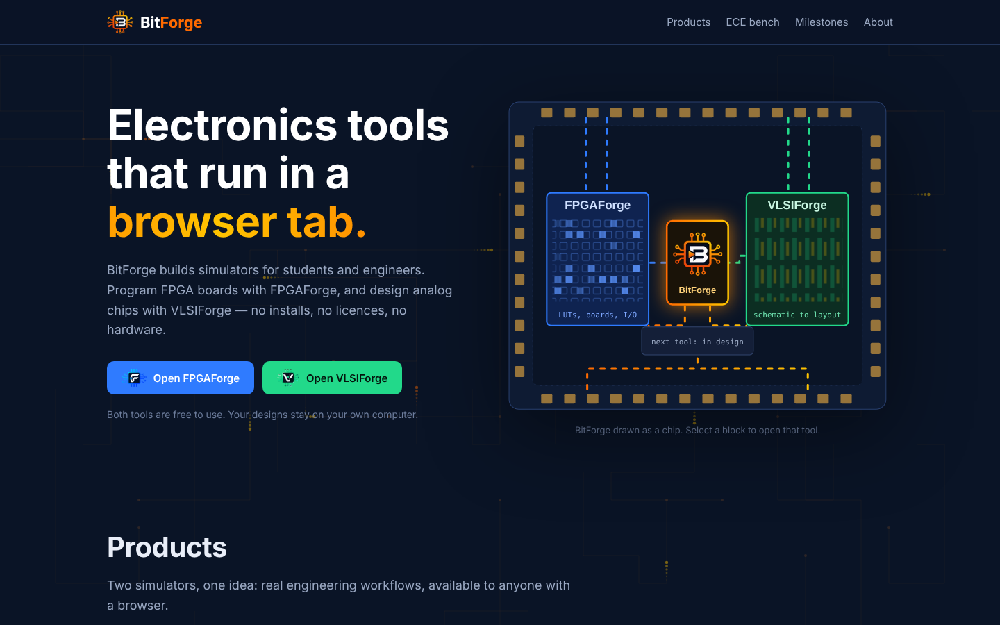
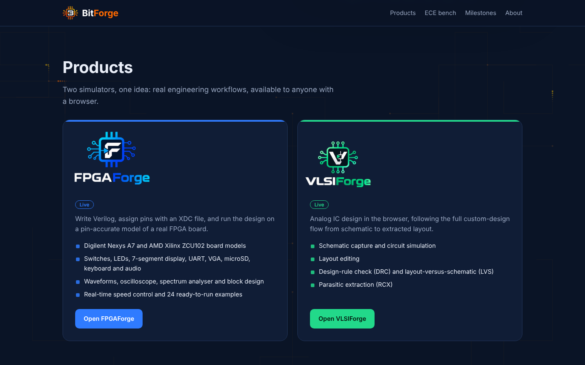
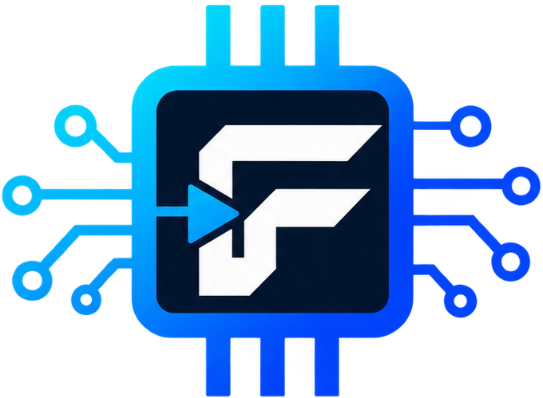
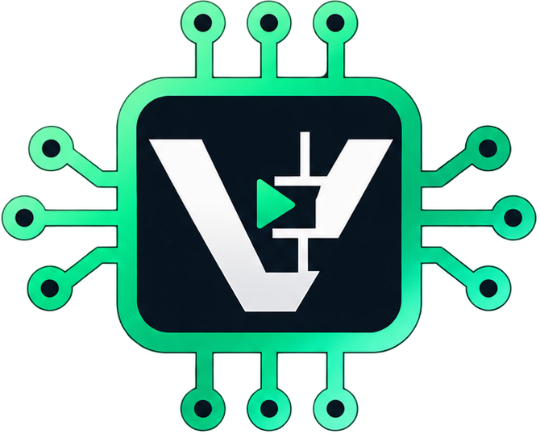
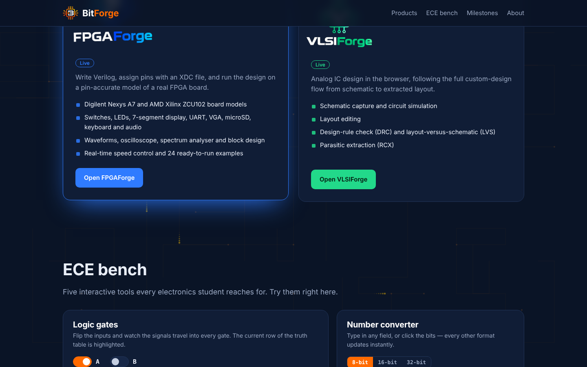
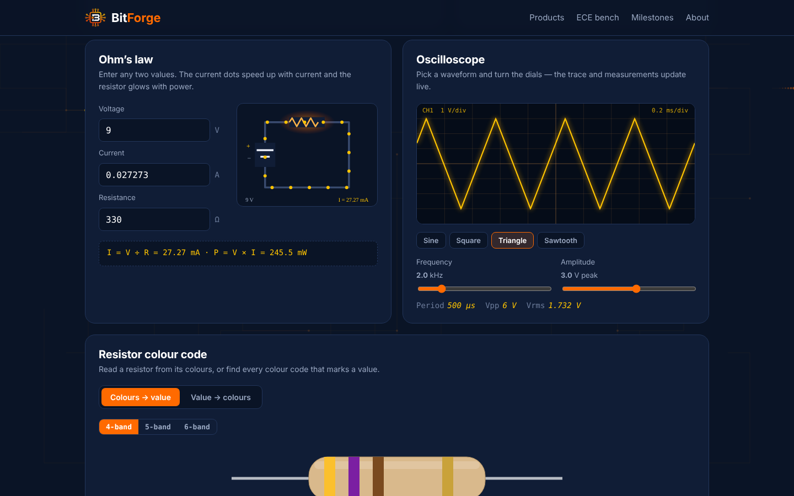
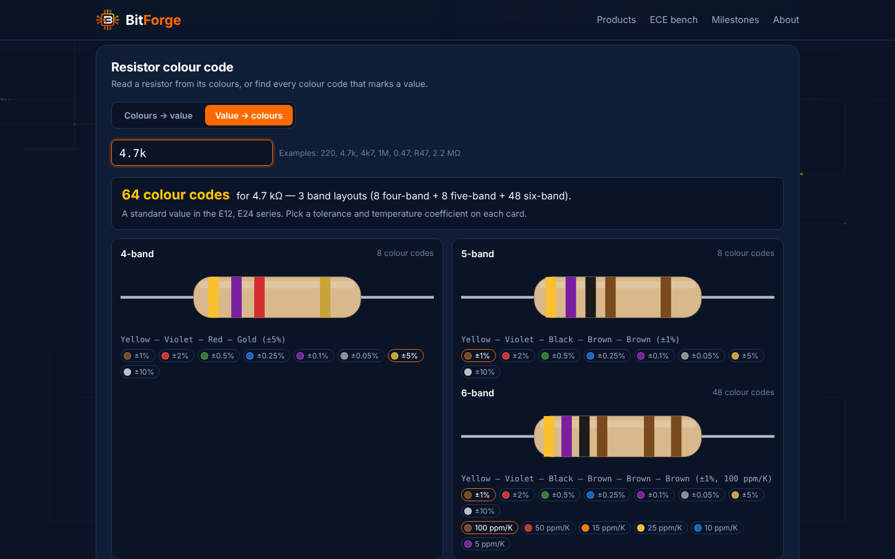

<div align="center">


### Electronics tools that run in a browser tab.

[](https://dedeep-vlsi-fe-engg.github.io/BitForge/)
[](https://dedeep-vlsi-fe-engg.github.io/FPGAForge/)
[](https://dedeep-vlsi-fe-engg.github.io/VLSIForge/)


**[Open BitForge](https://dedeep-vlsi-fe-engg.github.io/BitForge/)** · **[FPGAForge](https://dedeep-vlsi-fe-engg.github.io/FPGAForge/)** · **[VLSIForge](https://dedeep-vlsi-fe-engg.github.io/VLSIForge/)**

</div>

---

## Overview

**BitForge** builds browser-based simulators for electronics engineers and students. Its tools bring professional design workflows — FPGA development and analog IC design — to any modern browser, with no installation, no licences and no hardware.

This repository contains the **BitForge website**: the home of the BitForge product family, with an introduction to each product and an **ECE bench** of interactive tools for everyday electronics calculations.

<div align="center">
&nbsp;

</div>

---

## Products

<table>
<tr>
<td width="50%" valign="top">



### [FPGAForge](https://dedeep-vlsi-fe-engg.github.io/FPGAForge/)
FPGA boards in the browser. Write Verilog, assign pins with an XDC file, and run designs on pin-accurate models of the **Digilent Nexys A7** and **AMD Xilinx ZCU102** — with waveforms, an oscilloscope, a spectrum analyser, block design, real-time speed control and 24 examples.

</td>
<td width="50%" valign="top">



### [VLSIForge](https://dedeep-vlsi-fe-engg.github.io/VLSIForge/)
Analog IC design in the browser. The complete custom IC flow — **schematic → simulation → layout → DRC → LVS → parasitic extraction → GDSII** — with gpdk045, gpdk090, gpdk120 and gpdk180 technology kits.

</td>
</tr>
</table>

---

## Features

### Website
- **Chip-floorplan hero** — BitForge drawn as a die with a pad ring; FPGAForge and VLSIForge blocks are wired to a BitForge core with animated routing, the chip tilts with the pointer, and each block opens its product
- **Product cards** with logos, key features and launch links
- **Milestones** — a self-drawing timeline from the transistor (1947) to the first FPGA (1985)
- **Motion** — flowing circuit traces in the background and sections that reveal on scroll; all animation turns off with the system's reduced-motion setting

### ECE bench
| Tool | What it does |
|---|---|
| **Logic gates** | Toggle inputs A and B; AND, OR, XOR, NAND, NOR and XNOR respond with lit signal wires, output LEDs and a highlighted truth-table row |
| **Number converter** | Type in any format — decimal, signed (two's complement), hex, binary, octal, ASCII or Gray code — or click the bits; every other format updates instantly at 8, 16 or 32 bits |
| **Ohm's law** | Enter any two of V, I and R to get the third and the power; an animated circuit shows current flowing faster and the resistor glowing hotter |
| **Oscilloscope** | Sine, square, triangle and sawtooth with frequency and amplitude dials, a live trace, and period, Vpp and Vrms readouts |
| **Resistor colour code** | **Colours → value** for 4-, 5- and 6-band resistors, and **value → colours**: every valid colour code for a resistance, the number of possible codes, E12 / E24 / E96 checks, and the nearest markable values when a value cannot be colour-coded |

<div align="center">
&nbsp;
&nbsp;

</div>

---

## Getting started

1. Open **https://dedeep-vlsi-fe-engg.github.io/BitForge/**
2. Choose **Open FPGAForge** or **Open VLSIForge**, or select a block on the chip floorplan
3. Scroll to the **ECE bench** to use the calculators — no account needed

---

## Technology stack

- **Frontend:** vanilla JavaScript, SVG, HTML5 Canvas, CSS — delivered as a single self-contained `index.html`
- **Number converter:** BigInt arithmetic for exact 8-, 16- and 32-bit conversions
- **Resistor finder:** exact decimal parsing (`220`, `4.7k`, `4k7`, `R47`, `2.2 MΩ`) and enumeration of all 4-, 5- and 6-band codes
- **Fonts:** Chakra Petch, IBM Plex Sans and IBM Plex Mono (Google Fonts)
- **Privacy:** no accounts, no cookies, no tracking
- **Hosting:** GitHub Pages

---

## Repository structure

```
BitForge/
├── index.html          # The complete website
├── README.md
└── assets/             # Logos and screenshots used in this README
```

## Deployment

1. Upload `index.html` to this repository (branch `main`, root folder)
2. **Settings → Pages → Deploy from a branch → `main` / `root`**
3. To update, upload a new `index.html`; GitHub Pages republishes automatically (refresh with `Ctrl+Shift+R` if an old version appears)

---

## Browser support

All current versions of **Google Chrome**, **Microsoft Edge**, **Mozilla Firefox** and **Safari**, on desktop and mobile.

---

## Roadmap

New BitForge tools are in design. Feedback and suggestions are welcome via the contact below.

---

## Contact

**BitForge** — [dedeep-vlsi-fe-engg.github.io/BitForge](https://dedeep-vlsi-fe-engg.github.io/BitForge/)
Email: [fpgaforgedss@gmail.com](mailto:fpgaforgedss@gmail.com)

---

<div align="center">


**BitForge** — home of FPGAForge and VLSIForge · Developed by **DSS with Claude**

<sub>BitForge is an independent educational project. Product and company names mentioned are trademarks of their respective owners.</sub>

<sub>© 2026 BitForge. All rights reserved.</sub>

</div>
